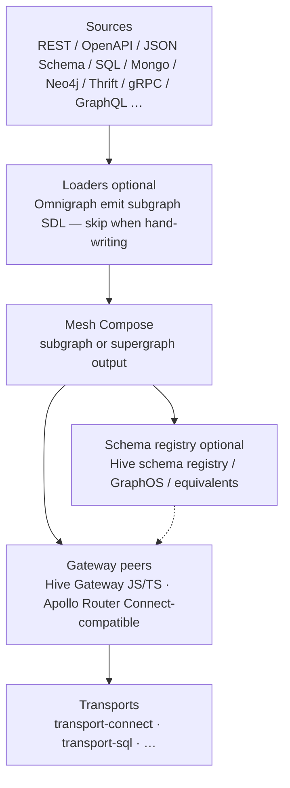

# Architecture

The product surface is GraphQL SDL with Mesh / Connectors-style directives, composed into a real
supergraph. Authors may generate that SDL from a loader or write it by hand; Compose and the gateway
treat both the same.

## Stack

**Captions**

- **Sources** feed either a loader or authored `.graphql`.
- **Loaders** are optional; hand-written SDL enters Compose the same way.
- **Mesh Compose** is the composition step for generated and authored subgraphs.
- **Schema registry** is optional publish/pull; gateways can also take Compose output directly.
- **Hive Gateway** (JS/TS) covers the full Mesh transport set; **Apollo Router** is a peer for
  Connect-compatible SDL.
- **Transports** execute directives at request time.

## Patterns

| Pattern                     | When                                                                                                |
| --------------------------- | --------------------------------------------------------------------------------------------------- |
| Dual-run same SDL           | Hive Gateway and Apollo Router both execute the same Connect supergraph.                            |
| Hive Gateway subgraph proxy | Non-Connect Mesh subgraphs served by Hive Gateway; a foreign router talks GraphQL to that subgraph. |
| Registry                    | Publish Mesh subgraphs (generated or hand-written); gateway pulls the supergraph.                   |
