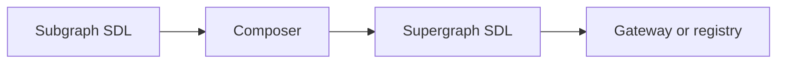

import { Cards } from '@theguild/components'
import { ApiRef } from '../../../components/v2-directive-ref'

# Composition

**Composition** combines one or more **subgraph** GraphQL schemas into a **supergraph** (or
validates a single subgraph for registry publish). Tooling is flexible: <ApiRef name="compose" />,
Hive composition, Rover, or another Federation-compatible composer.

## Where it lives



| Piece        | Role                                                                    |
| ------------ | ----------------------------------------------------------------------- |
| Inputs       | Loader emit **or** hand-written `.graphql`                              |
| Mesh Compose | Default snippets in Mesh docs (`mesh.config.ts`)                        |
| Outputs      | Supergraph file, subgraph SDL for registry, binary formats as supported |

Composition is **not** serving traffic, **not** executing transports, and **not** the schema
registry (though you often compose then publish).

## Short example

```ts
export const composeConfig = defineComposeConfig({
  subgraphs: [
    { sourceHandler: loadSqlSubgraph('catalog', { endpoint: 'file:chinook.db' }) },
    { name: 'recommendations', schema: './recommendations.graphql' }
  ]
})
```

Docs: [Compose](/v2/compose) · worked example in [Music Store Example](/v2/examples/music-store).

<Cards>
  <Cards.Card arrow title="Compose" href="/v2/compose" />
  <Cards.Card arrow title="Schema registry" href="/v2/concepts/schema-registry" />
  <Cards.Card arrow title="Concepts overview" href="/v2/concepts" />
</Cards>
