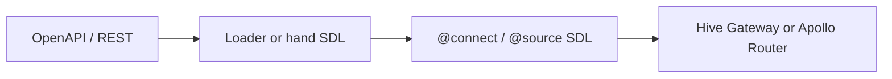

import { Cards } from '@theguild/components'
import { DirectiveRef } from '../../../components/v2-directive-ref'

# Connectors

**Connectors** (Apollo Connectors) are an HTTP-mapping style for GraphQL: fields declare how to call
REST with <DirectiveRef name="connect" /> and <DirectiveRef name="source" /> (connect/v0.4), plus
`selection` / entity flags. Mesh OpenAPI, JSON Schema, OData, and SOAP-as-Connect loaders **emit**
that shape. Hand authors can write the same directives.

## Where it lives



| Piece              | Role                                                                         |
| ------------------ | ---------------------------------------------------------------------------- |
| Directive contract | Apollo Connectors reference (upstream)                                       |
| Mesh transport     | `@graphql-mesh/transport-connect` on Hive Gateway                            |
| Dual-run           | Same Connect SDL on [Apollo Router](/v2/serve/apollo-router) when compatible |

Connectors are **not** Mesh-only, **not** SQL/gRPC mapping (those use protocol directives +

<DirectiveRef name="transport" />
), and **not** composition itself.

## Short example

```graphql
type Query {
  review(id: ID!): Review
    @connect(source: "reviews", http: { GET: "/reviews/{$args.id}" }, selection: "id rating body")
}
```

Arg tables: [Directives reference](/v2/reference/directives#connect) ·
[Apollo Connectors directives](https://www.apollographql.com/docs/graphos/connectors/reference/directives).

<Cards>
  <Cards.Card arrow title="Directives reference" href="/v2/reference/directives#connect" />
  <Cards.Card arrow title="Apollo Router" href="/v2/serve/apollo-router" />
  <Cards.Card arrow title="Concepts overview" href="/v2/concepts" />
</Cards>
