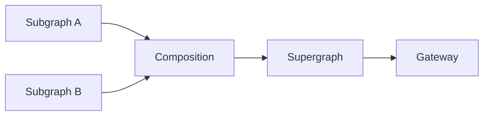

import { Cards } from '@theguild/components'
import { DirectiveRef } from '../../../components/v2-directive-ref'

# Federation

**GraphQL Federation** is the model for splitting a graph across **subgraphs** and combining them
into a **supergraph**. Entities use <DirectiveRef name="key" /> (and related Federation directives).
Gateways plan queries across subgraphs. Mesh aims to emit and accept **Federation-compatible**
subgraph SDL -- generated or hand-written.

## Where it lives



| Piece                                   | Role                                                              |
| --------------------------------------- | ----------------------------------------------------------------- |
| Subgraph SDL                            | Types, <DirectiveRef name="key" />, Connect / protocol directives |
| [Composition](/v2/concepts/composition) | Merge subgraphs → supergraph                                      |
| [Gateway](/v2/concepts/gateway)         | Execute the plan                                                  |

Federation is **not** schema stitching (see [Stitching](/v2/concepts/stitching)), **not** a
registry, and **not** a transport.

## Short example

```graphql
# Catalog subgraph
type Track @key(fields: "TrackId") {
  TrackId: Int!
  Name: String
}

# Reviews subgraph -- join stub
type Track @key(fields: "id", resolvable: false) {
  id: ID!
  reviews: [Review!]
}
```

See [Music Store Example](/v2/examples/music-store) and [FHIR](/v2/examples/fhir) for entity joins.

<Cards>
  <Cards.Card arrow title="Composition" href="/v2/concepts/composition" />
  <Cards.Card arrow title="Architecture" href="/v2/architecture" />
  <Cards.Card arrow title="Concepts overview" href="/v2/concepts" />
</Cards>
