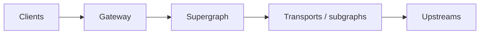

import { Cards } from '@theguild/components'
import { ApiRef } from '../../../components/v2-directive-ref'

# Gateway

A **gateway** is the runtime that accepts client GraphQL operations, plans them against a
**supergraph**, and executes subgraphs / transports. In Mesh v2 docs, two peers share the Serve nav:

| Gateway                         | Role                                                        |
| ------------------------------- | ----------------------------------------------------------- |
| <ApiRef name="hive-gateway" />  | Preferred Mesh runtime (JS/TS); full Mesh transport surface |
| <ApiRef name="apollo-router" /> | Peer for **Connect-compatible** SDL                         |

## Where it lives

The gateway is **not** Mesh Compose (that builds SDL), **not** the schema registry (that stores
SDL), and **not** a loader. It **consumes** composed or registry-sourced supergraph output.

## Short example

Compose once to a GraphQL supergraph file, then:

- Run the **full** multi-protocol graph on Hive Gateway (SQL + Connect + protobuf, …).
- Dual-run a **Connect-only** slice on Apollo Router when demonstrating compatibility.

See [Music Store Example](/v2/examples/music-store) gateway matrix and
[Architecture](/v2/architecture).

<Cards>
  <Cards.Card arrow title="Hive Gateway" href="/v2/serve/hive-gateway" />
  <Cards.Card arrow title="Apollo Router" href="/v2/serve/apollo-router" />
  <Cards.Card arrow title="Concepts overview" href="/v2/concepts" />
</Cards>
