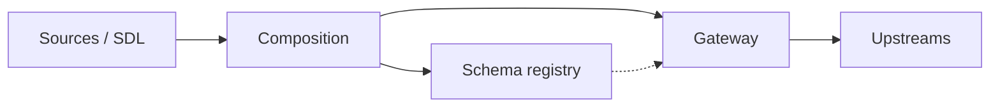

---
description:
  Mesh v2 concepts -- Mesh, Connectors, Federation, Stitching, Gateway, Composition, Schema registry
---

import { Cards } from '@theguild/components'

# Concepts

Short definitions for terms that show up across Mesh v2 docs. Each page answers: **what it is**,
**where it sits in the stack**, and a **tiny example**. Cross-link [Architecture](/v2/architecture),
[Compose](/v2/compose), and [Serve](/v2/serve/hive-gateway).

| Concept             | One line                                                                        | Page                                            |
| ------------------- | ------------------------------------------------------------------------------- | ----------------------------------------------- |
| **Mesh**            | Turns sources + SDL into Federation-ready subgraphs and transports              | [Mesh](/v2/concepts/mesh)                       |
| **Connectors**      | HTTP mapping style (`@connect` / `@source`) Mesh shares with Apollo             | [Connectors](/v2/concepts/connectors)           |
| **Federation**      | Entity/`@key` model for combining subgraphs into a supergraph                   | [Federation](/v2/concepts/federation)           |
| **Stitching**       | Older merge style (type merging / schema stitching) -- not the v2 default story | [Stitching](/v2/concepts/stitching)             |
| **Gateway**         | Runtime that executes the supergraph (Hive Gateway · Apollo Router)             | [Gateway](/v2/concepts/gateway)                 |
| **Composition**     | Combining subgraph SDL into a supergraph (Mesh Compose, Hive, Rover, …)         | [Composition](/v2/concepts/composition)         |
| **Schema registry** | Stores and distributes subgraph / supergraph SDL                                | [Schema registry](/v2/concepts/schema-registry) |

## Where to go next

<Cards>
  <Cards.Card arrow title="Architecture" href="/v2/architecture" />
  <Cards.Card arrow title="Compose" href="/v2/compose" />
  <Cards.Card arrow title="Hive Gateway" href="/v2/serve/hive-gateway" />
  <Cards.Card arrow title="Apollo Router" href="/v2/serve/apollo-router" />
  <Cards.Card arrow title="Directives reference" href="/v2/reference/directives" />
</Cards>
