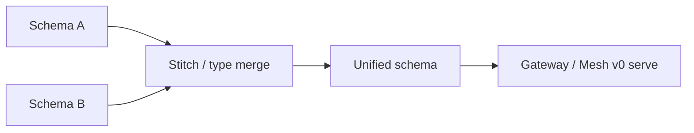

import { Callout, Cards } from '@theguild/components'

# Stitching

**Schema stitching** (and Mesh v0-era **type merging**) combines GraphQL schemas by merging types
and wiring fields with stitch/merge directives or resolvers -- historically without the Federation
entity/`@key` planner as the primary contract.

## Where it lives (historically)

In **Mesh v2 docs**, the default product story is **Federation-ready subgraphs** + composition +
Hive Gateway / Apollo Router -- not stitching as the kickoff path. Legacy v0 `/docs` still documents
older merge patterns where needed.

<Callout type="info">
  Prefer [Federation](/v2/concepts/federation) + [Compose](/v2/compose) for new Mesh work. Use this
  page only to orient readers coming from stitching / type-merging docs.
</Callout>

## Short contrast

|                 | Stitching / type merge      | Federation (Mesh v2 default)                 |
| --------------- | --------------------------- | -------------------------------------------- |
| Join model      | Merge types / stitch fields | Entities + `@key`                            |
| Composition     | Stitch tools / Mesh v0      | Mesh Compose / Hive / Rover                  |
| Router dual-run | N/A Connect story           | Connect SDL on Apollo Router when compatible |

<Cards>
  <Cards.Card arrow title="Federation" href="/v2/concepts/federation" />
  <Cards.Card arrow title="Compose" href="/v2/compose" />
  <Cards.Card arrow title="Concepts overview" href="/v2/concepts" />
</Cards>
