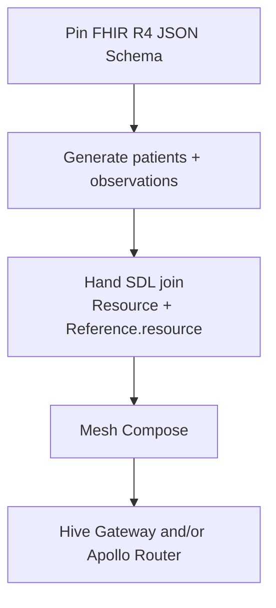

import { Callout, Cards } from '@theguild/components'

# FHIR (JSON Schema) -- supporting example

<Callout type="info">
  Supporting narrative alongside the main Mesh v2 docs -- **not** the getting-started kickoff.
  Prefer [Music store](/v2/examples/music-store) for the staged tutorial.
</Callout>

How we built the Mesh FHIR e2e (`e2e/json-schema-fhir` on `master`): generate Patient and
Observation from HL7 R4 JSON Schema, hand-write a join-only Resource subgraph, compose once, serve
on **Hive Gateway** (JS/TS) and **Apollo Router**.



## 1. Pin the R4 schema

Download HL7 R4 `fhir.schema.json` (not a floating "latest" zip). Reject R5-shaped or stale files:
`Patient.id` must point at `#/definitions/id`, and `Observation.status` must be an inline enum.

## 2. Map primitives, set the base URL

Force a shared scalar map so both generated subgraphs agree -- especially **`id` / `oid` → GraphQL
`ID`**. Drive the REST base from `FHIR_BASE` at compose and serve time (e2e default:
`https://hapi.fhir.org/baseR4`).

## 3. Generate the Patient and Observation subgraphs

Two JSON Schema subgraphs, each with one root query against the live FHIR server:

| Subgraph       | Root field            | Upstream                                              |
| -------------- | --------------------- | ----------------------------------------------------- |
| `patients`     | `patient(id)`         | `GET /Patient/{id}` → `#/definitions/Patient`         |
| `observations` | `observationById(id)` | `GET /Observation/{id}` → `#/definitions/Observation` |

The loader emits full types and auto `@connect(selection:)` -- no hand selection on these fields.
[Read the emitted SDL](/v2/guides/reading-generated-sdl) the same way as Music store stage 1.

## 4. Hand-write the join-only Reference subgraph

File: `reference-resource.graphql`. **No `Query`** -- other subgraphs own roots.

- `interface Resource { id: ID }`
- **Opt-in** `Patient` / `Observation` `implements Resource` with
  `@key(fields: "id", resolvable: false)`
- `Reference.resource` via Connect `->match` on `Type/id` (for example `Patient/nhanes-112200`)

Wire it as a schema file subgraph in Compose:

```ts
{
  name: 'referenceResource',
  schema: './reference-resource.graphql',
}
```

**Why not auto-derive every Resource?** Official FHIR JSON Schema defines hundreds of resources.
Opt-in stubs match only the types you federate.

## 5. Compose once, serve twice

Compose to GraphQL SDL, then execute the **same** file on Hive Gateway and Apollo Router (Connect
path). Example hydration query: `observationById` → `subject.resource` → `... on Patient { name }`.

## Repo anchors

- `e2e/json-schema-fhir/mesh.config.ts`
- `e2e/json-schema-fhir/reference-resource.graphql`
- `e2e/json-schema-fhir/ensure-fhir-schema.ts`
- `e2e/json-schema-fhir/json-schema-fhir.test.ts`

<Cards>
  <Cards.Card arrow title="Music store" href="/v2/examples/music-store" />
  <Cards.Card arrow title="Generate" href="/v2/paths/generate" />
  <Cards.Card arrow title="Hand-write" href="/v2/paths/hand-write" />
  <Cards.Card arrow title="Reading generated SDL" href="/v2/guides/reading-generated-sdl" />
</Cards>
