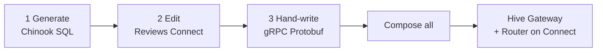

---
description:
  Music Store Example -- Chinook SQL, Reviews REST/OpenAPI Connect, gRPC in three pedagogical stages
---

import { Callout, Cards } from '@theguild/components'

# Music Store Example

Build one music-store supergraph in **three pedagogical stages** (D14): Generate →
Generate-then-edit → Hand-write. Protocols (D8/D12/D13): **Chinook SQL** catalog, **Reviews** REST /
OpenAPI → `@connect`, **gRPC / Protobuf** recommendations.

Path pages teach the skill; this example walks the stages in order, then composes and serves.



<Callout type="info">
  User-facing copy says **REST / OpenAPI** for Reviews. feTS may power the OpenAPI server for
  dogfood; it is not the product brand. Snippets below match Mesh Compose shape; wire fixtures from
  the repo anchors as you expand the runnable example.
</Callout>

## What you build

| Stage                     | Skill page                                         | Protocol                   | Authoring                                     |
| ------------------------- | -------------------------------------------------- | -------------------------- | --------------------------------------------- |
| **1. Generate**           | [Generate](/v2/paths/generate)                     | Chinook **SQL** (SQLite)   | `loadSqlSubgraph` → read emitted SDL          |
| **2. Generate-then-edit** | [Generate-then-edit](/v2/paths/generate-then-edit) | **Reviews** REST / OpenAPI | Generate `@connect`, dislike/edit, re-compose |
| **3. Hand-write**         | [Hand-write](/v2/paths/hand-write)                 | **gRPC / Protobuf**        | Authored `@protobuf__rpc` + `@link` imports   |

Federation hub: stage 1 emits `Track @key`. Stages 2–3 extend Track (`@connect(entity: true)` /
`@protobuf__rpc` + `@key`).

## Gateway matrix

| Slice                     | Hive Gateway (JS/TS) | Apollo Router                  |
| ------------------------- | -------------------- | ------------------------------ |
| Full multi-protocol graph | Yes                  | No (SQL + protobuf transports) |
| Connect Reviews slice     | Yes                  | Yes (dual-run)                 |
| gRPC slice                | Yes                  | No                             |

---

## Stage 1 -- Generate the Chinook catalog

Skill: [Generate](/v2/paths/generate) · Reading:
[Reading generated SDL](/v2/guides/reading-generated-sdl)

1. Point Mesh Compose at Chinook (SQLite) with the SQL loader.
2. Compose and query a Track (and related album/artist fields as emitted).
3. Open the emitted subgraph SDL. Find `@transport`, `@sql` / `@sql__*`, and
   `Track @key(fields: "TrackId")` (exact field names follow the loader emit).
4. Keep this subgraph as the federation hub before adding Reviews or gRPC.

```ts
import { defineConfig as defineComposeConfig } from '@graphql-mesh/compose-cli'
import { loadSqlSubgraph } from '@omnigraph/sql'

export const composeConfig = defineComposeConfig({
  subgraphs: [
    {
      sourceHandler: loadSqlSubgraph('catalog', {
        endpoint: 'file:chinook.db'
      })
    }
  ]
})
```

```graphql
# Shape of what to look for in emitted SDL (names follow loader output)
type Track @key(fields: "TrackId") {
  TrackId: Int!
  Name: String
  # … AlbumId, Milliseconds, …
}
```

Repo anchor: `e2e/sqlite-chinook`.

---

## Stage 2 -- Generate Reviews, then edit

Skill: [Generate-then-edit](/v2/paths/generate-then-edit)

1. Stand up (or reuse) a **REST** Reviews API with an OpenAPI document (feTS OK under the hood).
2. Generate a Reviews subgraph with the OpenAPI loader → Connect emit.
3. Query a review; [read the SDL](/v2/guides/reading-generated-sdl) (`@source`, `@connect`,
   `selection`).
4. **Dislike** something concrete (field names, noisy types, Track join shape).
5. Edit the checked-in `.graphql` (or apply optional [Transforms](/v2/transforms) for rename-only
   cases).
6. Re-compose. Dual-run the Connect slice on **Hive Gateway** and **Apollo Router**.

```ts
{
  sourceHandler: loadOpenAPISubgraph('reviews', {
    source: 'http://localhost:4001/openapi.json',
    endpoint: 'http://localhost:4001',
  }),
  // optional: transforms: [createPrefixTransform({ … })]
}
```

```graphql
# After edit -- Reviews extend catalog Track (entity: true pattern)
type Track @key(fields: "id", resolvable: false) {
  id: ID!
  reviews: [Review!]
    @connect(
      source: "reviews"
      http: { GET: "/reviews?trackId={$this.id}" }
      selection: """
      id
      rating
      body
      """
    )
}
```

Exact `@connect` args follow connect/v0.4 emit; align `id` / `TrackId` keys with stage 1 when you
merge. Repo anchors: `e2e/openapi-entity-stubs`, `e2e/petstore-subgraph`.

---

## Stage 3 -- Hand-write gRPC / Protobuf

Skill: [Hand-write](/v2/paths/hand-write)

1. Import Mesh / Federation directives with `@link` (Compose injects definitions).
2. Author Query fields with `@protobuf__rpc` (`service`, `method`, `args`, `selection`).
3. Add `@transport(kind: "protobuf", …)` and `@key` where entities join Track.
4. Load the `.graphql` as a schema subgraph in Compose (same path as edited SDL).
5. Serve on **Hive Gateway** only for this slice.

```graphql
extend schema
  @link(url: "https://specs.apollo.dev/federation/v2.6", import: ["@key"])
  @link(url: "https://specs.graphql-mesh.com/core/v0.1", import: ["@transport"])
  @link(url: "https://specs.graphql-mesh.com/protobuf/v0.1", import: ["@protobuf__rpc"])

schema
  @transport(subgraph: "recommendations", kind: "protobuf", location: "http://localhost:50051") {
  query: Query
}

type Query {
  recommendation(trackId: ID!): Recommendation!
    @protobuf__rpc(
      service: "Recommendations"
      method: "GetRecommendation"
      args: """
      1(string): $args.trackId
      """
      selection: """
      1(string): id
      2(string): trackId
      """
    )
}

type Recommendation @key(fields: "id") {
  id: ID!
  trackId: ID!
}
```

```ts
{
  name: 'recommendations',
  schema: './recommendations.graphql',
}
```

Repo anchors: `e2e/protobuf-http`, `e2e/protobuf-grpc-example`.

---

## Compose all three, then serve

Skill: [Compose](/v2/compose) · Serve: [Hive Gateway](/v2/serve/hive-gateway) ·
[Apollo Router](/v2/serve/apollo-router)

1. List all three subgraphs in one `mesh.config.ts` (catalog + reviews + recommendations).
2. Compose to a supergraph GraphQL file.
3. Run the **full** graph on Hive Gateway (JS/TS) -- SQL + Connect + protobuf transports.
4. Dual-run the **Connect Reviews** slice on Apollo Router when demonstrating Connect compatibility.
5. Optional: publish each subgraph SDL to a schema registry with the same UX as generated subgraphs.

```ts
export const composeConfig = defineComposeConfig({
  subgraphs: [
    { sourceHandler: loadSqlSubgraph('catalog', { endpoint: 'file:chinook.db' }) },
    { sourceHandler: loadOpenAPISubgraph('reviews', {/* OpenAPI source + endpoint */}) },
    { name: 'recommendations', schema: './recommendations.graphql' }
  ]
})
```

## Supporting example

Healthcare JSON Schema join story (not this walkthrough): [FHIR](/v2/examples/fhir).

<Cards>
  <Cards.Card arrow title="Generate" href="/v2/paths/generate" />
  <Cards.Card arrow title="Generate-then-edit" href="/v2/paths/generate-then-edit" />
  <Cards.Card arrow title="Hand-write" href="/v2/paths/hand-write" />
  <Cards.Card arrow title="Compose" href="/v2/compose" />
  <Cards.Card arrow title="Hive Gateway" href="/v2/serve/hive-gateway" />
  <Cards.Card arrow title="Apollo Router" href="/v2/serve/apollo-router" />
</Cards>
