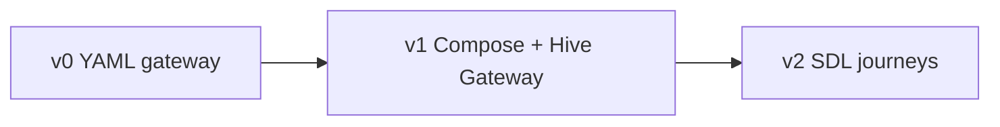

import { Callout, Cards } from '@theguild/components'
import { ConceptRef } from '../../../components/v2-directive-ref'

# Mesh journey (v0 → v1 → v2)

How Mesh's docs story evolved. Use this to orient if you know an older Mesh, then jump into
[v2](/v2).

| Era    | Docs                 | Product shape                                                                                                                                                                                                                                                   |
| ------ | -------------------- | --------------------------------------------------------------------------------------------------------------------------------------------------------------------------------------------------------------------------------------------------------------- |
| **v0** | [`/docs`](/docs)     | YAML `.meshrc`, built-in serve, handlers / plugins / cache -- config-first gateway                                                                                                                                                                              |
| **v1** | [`/v1`](/v1)         | <ConceptRef name="composition" label="Compose" /> + <ConceptRef name="gateway" label="Hive Gateway" />; still mostly **generate-first** from source handlers                                                                                                    |
| **v2** | [`/v2`](/v2) (draft) | **SDL-first**: equal [Generate](/v2/paths/generate) / [Hand-write](/v2/paths/hand-write) / [Generate-then-edit](/v2/paths/generate-then-edit); <ConceptRef name="connectors" />; <ConceptRef name="federation" /> subgraphs; Hive Gateway + Apollo Router peers |

## What changed

- **v0 → v1:** composition and Hive Gateway replace the all-in-one YAML serve story; loaders still
  lead.
- **v1 → v2:** authored and edited SDL are first-class (same Compose + registry path as generate);
  reading emitted directives is a shared skill; Connect dual-run and non-Connect protocol transports
  are explicit.

<Callout type="info">
  Production docs remain on [Mesh v1](/v1) until v2 ships. Legacy v0 stays under `/docs`.
</Callout>

## Where to go next

<Cards>
  <Cards.Card arrow title="Mesh v2 intro" href="/v2" />
  <Cards.Card arrow title="Concepts" href="/v2/concepts" />
  <Cards.Card arrow title="Architecture" href="/v2/architecture" />
  <Cards.Card arrow title="Music Store Example" href="/v2/examples/music-store" />
  <Cards.Card arrow title="Mesh v1 docs" href="/v1" />
</Cards>
