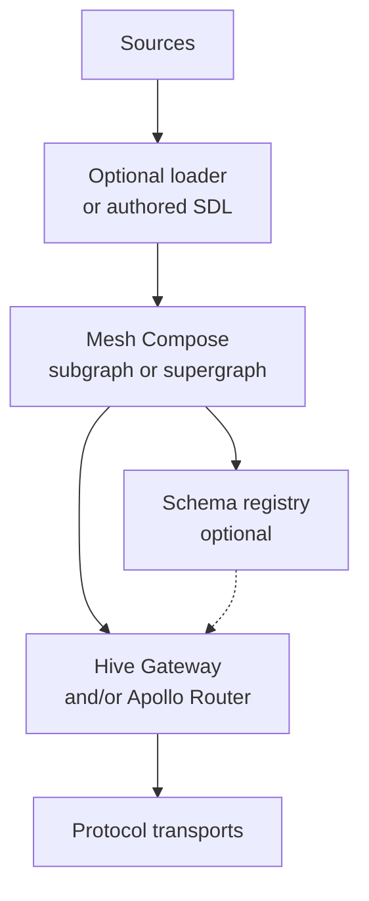

import { Callout, Cards } from '@theguild/components'
import { V2JourneyCards } from '../../components/v2-journey-cards'

# Mesh v2 (draft)

<Callout type="info">
  This is a **draft** of the Mesh v2 docs IA. Content is incomplete and under review. Prefer [Mesh
  v1](/v1) for production docs until this section ships.
</Callout>

**Mesh** turns GraphQL and non-GraphQL sources into Federation-ready subgraphs (and optionally a
composed supergraph). Authors work in GraphQL SDL with Mesh / Connectors-style directives.

- **Hive Gateway** (JavaScript / TypeScript) is the preferred runtime for the full Mesh transport
  surface.
- **Apollo Router** is a first-class peer for **Connect-compatible** supergraphs.
- Composition is flexible: Mesh Compose, Hive composition, Rover, or another Federation-compatible
  composer.

## Choose your path

Three equal journeys. No primary funnel.

<V2JourneyCards />

## Where to go next

<Cards>
  <Cards.Card arrow title="Architecture" href="/v2/architecture" />
  <Cards.Card arrow title="Compose" href="/v2/compose" />
  <Cards.Card arrow title="Serve: Hive Gateway" href="/v2/serve/hive-gateway" />
  <Cards.Card arrow title="Serve: Apollo Router" href="/v2/serve/apollo-router" />
  <Cards.Card arrow title="Tutorial: Music store" href="/v2/tutorials/music-store" />
  <Cards.Card arrow title="Reading generated SDL" href="/v2/guides/reading-generated-sdl" />
</Cards>
