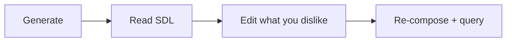

import { Cards } from '@theguild/components'

# Generate-then-edit

Generate gets you a working subgraph fast. Generate-then-edit is when you **dislike** the shape --
names, extras, selection maps -- and take ownership: edit the `.graphql`, re-compose, re-query.
Compose, schema registry, and gateway treat that edited file the same as hand-written SDL.

## In the Music store

Stage 2 of the [Music store](/v2/tutorials/music-store) generates **Reviews** from a REST / OpenAPI
source (Connect emit), then edits the `@connect` SDL before it joins the catalog.

| Step       | Music store move                                                                                |
| ---------- | ----------------------------------------------------------------------------------------------- |
| Generate   | Reviews OpenAPI → Connect subgraph beside Chinook                                               |
| Dislike    | Naming, selection, or entity wiring that does not match the catalog keys                        |
| Edit       | Checked-in `.graphql` with the fixes you want                                                   |
| Re-compose | Same Compose pipeline as hand-write; dual-run Hive Gateway + Apollo Router on the Connect slice |

You practice [Reading generated SDL](/v2/guides/reading-generated-sdl) on stage 1 output before this
edit. Transforms (rename, prefix, naming-convention) can help keep `$args` / `$this` mappings valid
for dual-run -- covered in the Transforms chapter later.

Full stage walkthrough: [Music store](/v2/tutorials/music-store).

<Cards>
  <Cards.Card arrow title="Generate" href="/v2/paths/generate" />
  <Cards.Card arrow title="Hand-write" href="/v2/paths/hand-write" />
  <Cards.Card arrow title="Music store tutorial" href="/v2/tutorials/music-store" />
</Cards>
