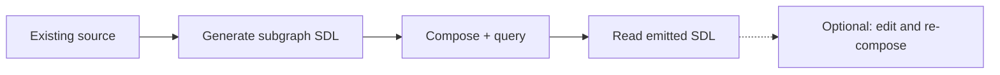

---
description:
  Convert existing sources into Federation-ready Mesh subgraphs, then read the emitted SDL
---

import { Cards } from '@theguild/components'

# Generate

Turn the APIs and databases you already have into **Federation-ready subgraphs**. Mesh Compose emits
GraphQL SDL stamped with directives; you query it on **Hive Gateway** (and on **Apollo Router** when
the SDL is Connect-compatible). You do not have to write directive args by hand to get a first
working query.

Emitted SDL is yours. You can always edit it and feed the file back into Compose, a schema registry,
and the gateway -- that path is [Generate-then-edit](/v2/paths/generate-then-edit).



## In the Music store

Stage 1 of the [Music store](/v2/tutorials/music-store) tutorial generates the **Chinook SQL
catalog** first -- the federation hub -- then asks you to read the emitted SDL (especially Track
`@key`) before anything else is authored.

| What you generate   | Why it leads                                                 |
| ------------------- | ------------------------------------------------------------ |
| Chinook SQL catalog | Domain starts with catalog; generate-first lesson stays true |

```ts
// Sketch -- Music store stage 1
export const composeConfig = defineComposeConfig({
  subgraphs: [
    {
      sourceHandler: loadSqlSubgraph('catalog', {/* Chinook connection + tables */})
    }
  ]
})
```

After compose, query a Track, then open the emitted SDL and find the directives that made the query
work. Full stage walkthrough: [Music store](/v2/tutorials/music-store). How to read what you got:
[Reading generated SDL](/v2/guides/reading-generated-sdl).

## Loaders (reference)

Point a Mesh loader at OpenAPI, SQL, JSON Schema, Mongo, Protobuf, and other sources. The product
story is the emitted subgraph; loader names are the API you call when configuring Compose.

<Cards>
  <Cards.Card arrow title="Generate-then-edit" href="/v2/paths/generate-then-edit" />
  <Cards.Card arrow title="Reading generated SDL" href="/v2/guides/reading-generated-sdl" />
  <Cards.Card arrow title="Music store tutorial" href="/v2/tutorials/music-store" />
</Cards>
