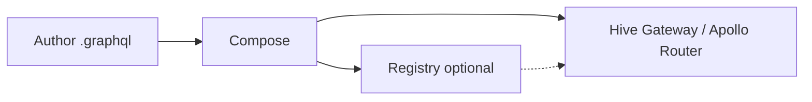

import { Cards } from '@theguild/components'

# Hand-write

Author a committed `.graphql` as the source of truth -- Mesh / Connectors-style directives,
Federation `@key` where you need entities -- then drop that file into **Compose** and a **schema
registry** the same way generated subgraphs do. Humans and AI assistants share **one** authoring
contract; there is no separate "AI write" path.

Prefer starting from a [read of generated SDL](/v2/guides/reading-generated-sdl) when one exists.
Edited generate output and scratch-authored SDL use the same Compose input.



## In the Music store

Stage 3 of the [Music store](/v2/tutorials/music-store) hand-writes the **gRPC / Protobuf** slice
after you have already generated the catalog and edited Reviews Connect. By then the directive
patterns are familiar; you author the smaller RPC surface into Compose (+ registry) yourself.

| What you hand-write | Why it fits stage 3                                        |
| ------------------- | ---------------------------------------------------------- |
| gRPC / Protobuf SDL | Smaller authored surface; Hive Gateway only for that slice |

```graphql
# Sketch -- Music store stage 3 idea (protocol SDL, not a full service)
extend schema @link(url: "https://specs.apollo.dev/federation/v2.6", import: ["@key"])

type Query {
  recommendation(trackId: ID!): Recommendation
}

type Recommendation @key(fields: "id") {
  id: ID!
  trackId: ID!
}
```

Wire the file as a schema subgraph in Compose (same path as join-only / edited SDL). Serve the full
multi-protocol graph on **Hive Gateway** (JS/TS); use **Apollo Router** only on Connect-compatible
slices.

Full stage walkthrough: [Music store](/v2/tutorials/music-store). Compose details:
[Compose](/v2/compose).

<Cards>
  <Cards.Card arrow title="Compose" href="/v2/compose" />
  <Cards.Card arrow title="Reading generated SDL" href="/v2/guides/reading-generated-sdl" />
  <Cards.Card arrow title="Music store tutorial" href="/v2/tutorials/music-store" />
</Cards>
